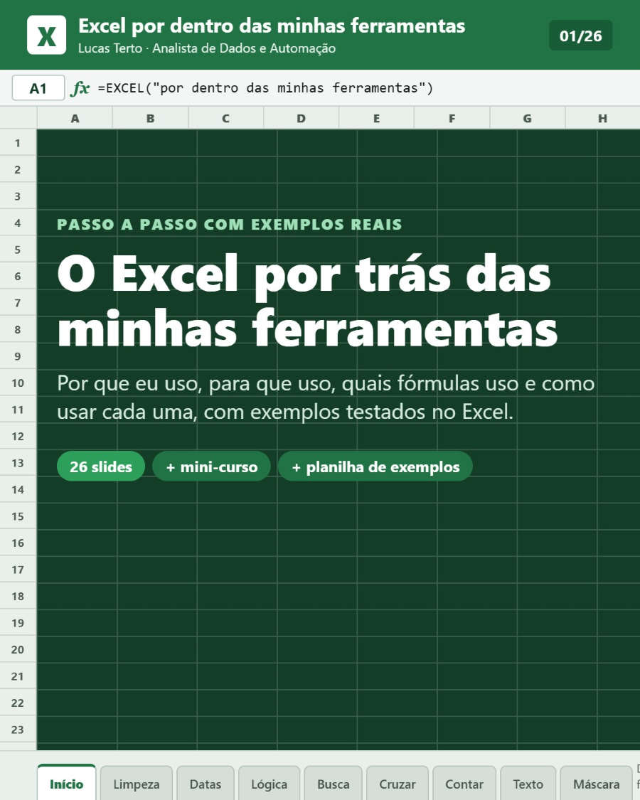
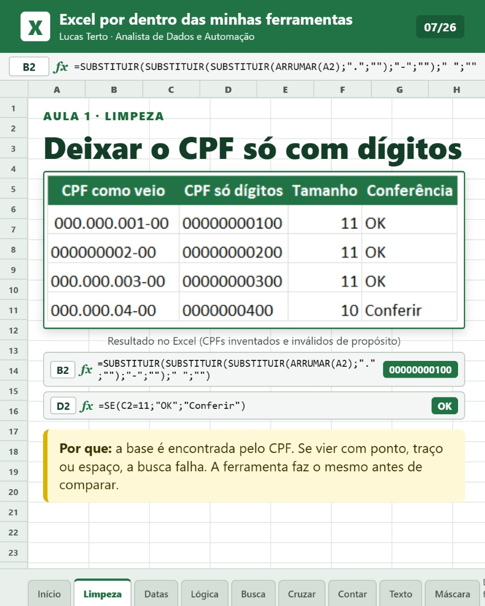
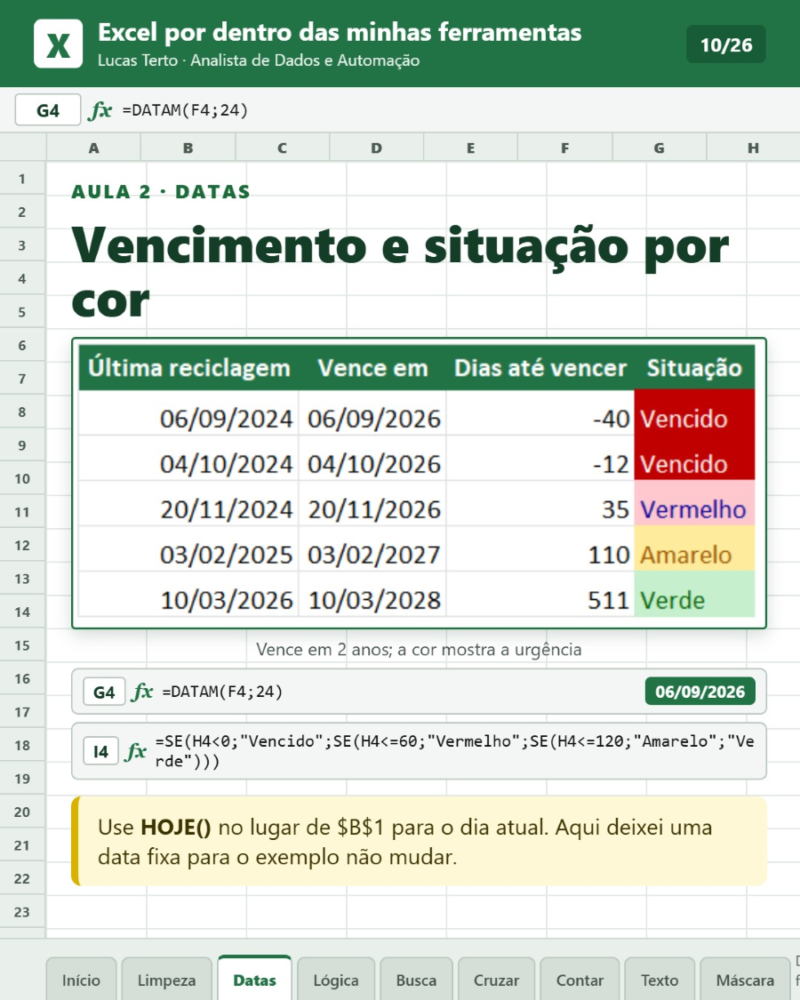
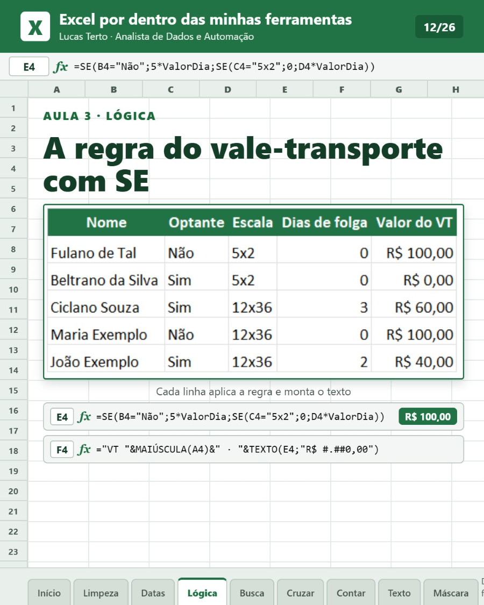
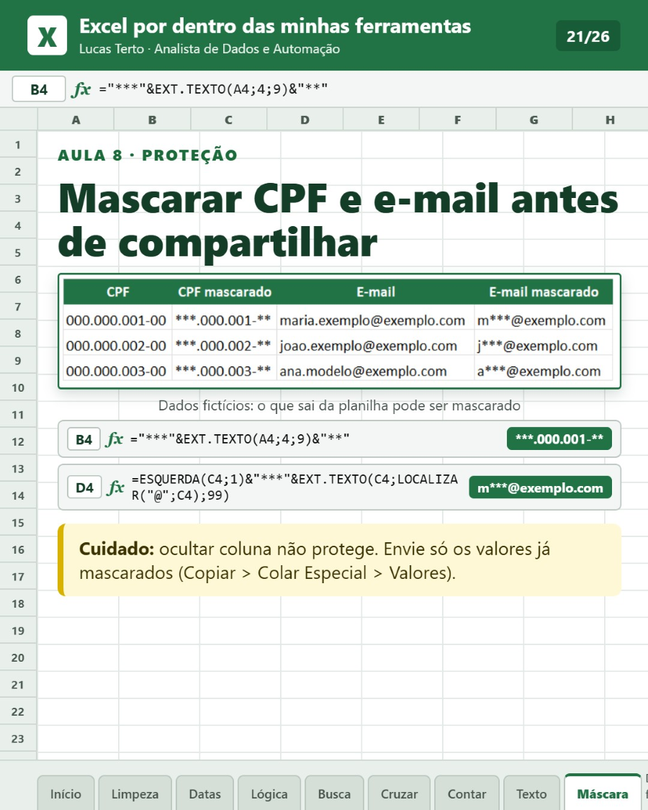

# Excel: fórmulas na prática

Uma planilha de exemplos com 8 abas (uma por aula), um mini-curso em PDF e um carrossel que explicam o Excel que está por trás das ferramentas de automação que eu crio: **por que** usar cada fórmula, **quando** usar e **como** montar.

> **Dados fictícios.** Todos os nomes, CPFs, e-mails, REs e valores foram inventados. Os CPFs são inválidos de propósito.

## Por que este repositório existe

Antes de virar código, toda automação começa como uma regra na planilha. Aqui eu mostro essas regras do jeito que aparecem no dia a dia administrativo: limpar CPF, contar dias úteis, calcular vale-transporte, cruzar listas, somar com condição e mascarar dados pessoais antes de compartilhar.

Este material acompanha a publicação no LinkedIn de 24/10/2026: [Excel por dentro das minhas ferramentas](https://www.linkedin.com/feed/update/urn:li:activity:7519777734840172546/).

## O que tem aqui

| Arquivo | O que é |
|---|---|
| [`planilha/excel-formulas-na-pratica.xlsx`](planilha/excel-formulas-na-pratica.xlsx) | Planilha de exemplos com 8 abas e as fórmulas já montadas |
| [`docs/formulas.md`](docs/formulas.md) | Lista de todas as fórmulas da planilha, com a célula e o resultado |
| [`docs/como-estudar.md`](docs/como-estudar.md) | Roteiro de estudo e o que cada aula ensina |
| [Releases](../../releases) | Mini-curso em PDF (23 páginas) e carrossel em PDF (26 slides) |

## As aulas

| Aba da planilha | O que você aprende |
|---|---|
| Aula 1 - Limpeza | `ARRUMAR`, `SUBSTITUIR`, `MAIÚSCULA`, `PRI.MAIÚSCULA`, `TEXTO` com zeros à esquerda |
| Aula 2 - Datas | `DIATRABALHO`, `DIATRABALHOTOTAL`, `DATAM`, cores de vencimento (formatação condicional) |
| Aula 3 - Lógica (VT) | `SE` encadeado, `SES`, célula nomeada e lista suspensa |
| Aula 4 - Busca | `PROCX`, `PROCV`, `ÍNDICE` + `CORRESP`, `SEERRO` |
| Aula 5 - Cruzar listas | `CONT.SE` para achar quem entrou e quem saiu, `FILTRO` |
| Aula 6 - Contar e somar | `CONT.SES`, `SOMASE`, `SOMASES`, `MÉDIASE` e conferência final |
| Aula 7 - Desconto | `TEXTO` com data e moeda, `&`, `CONT.VALORES` |
| Aula 8 - Máscara LGPD | `EXT.TEXTO`, `ESQUERDA`, `LOCALIZAR` para mascarar CPF e e-mail |

O mini-curso traz ainda tabela dinâmica, Power Query, como proteger a planilha antes de enviar e quando vale sair do Excel e partir para código.

## Exemplos

| Limpar CPF | Vencimento por cor |
|---|---|
|  |  |
| **Regra do vale-transporte** | **Mascarar CPF e e-mail** |
|  |  |

## Como usar

1. Baixe a planilha (botão **Download raw** na página do arquivo).
2. Abra no Excel e vá para a aba da aula.
3. Clique nas células e leia a fórmula na barra de fórmulas.
4. Mude um valor e veja o resultado mudar.
5. Para o passo a passo completo, baixe o mini-curso em [Releases](../../releases).

## Requisitos e o que foi testado

- Testado no **Microsoft 365 (Excel em português do Brasil)**, no Windows 10. Em 26/10/2026 as 61 fórmulas foram recalculadas e todas deram o resultado esperado.
- `PROCX` e `FILTRO` exigem Excel 2021 ou Microsoft 365, e `SES` exige Excel 2019 ou mais novo. O mini-curso mostra alternativas para versões antigas.
- **Não testado:** LibreOffice, Google Planilhas e Excel em outros idiomas. Em inglês, os nomes das funções e o separador (`,` no lugar de `;`) mudam.

## Ferramentas usadas

- Microsoft Excel 365 (planilha e capturas das tabelas)
- HTML e CSS para montar os slides e o mini-curso, convertidos em PDF por um script em PowerShell
- [Claude Code](https://claude.com/claude-code) como apoio: eu defino o conteúdo e as regras, testo e confiro tudo

## Licença

Conteúdo (planilha, textos, PDFs e imagens) sob [Creative Commons Atribuição 4.0 (CC BY 4.0)](LICENSE.md): pode usar, adaptar e compartilhar, desde que cite a fonte.

## Autor

**Lucas Terto**, Assistente Administrativo com foco em Análise de Dados e Automação.
[LinkedIn](https://www.linkedin.com/in/soulucas1212)
