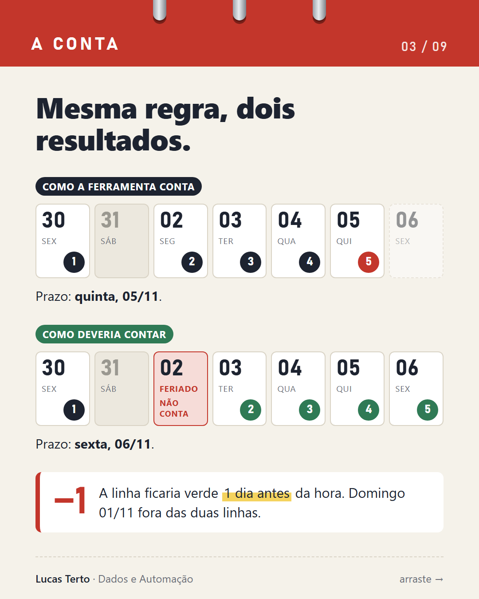
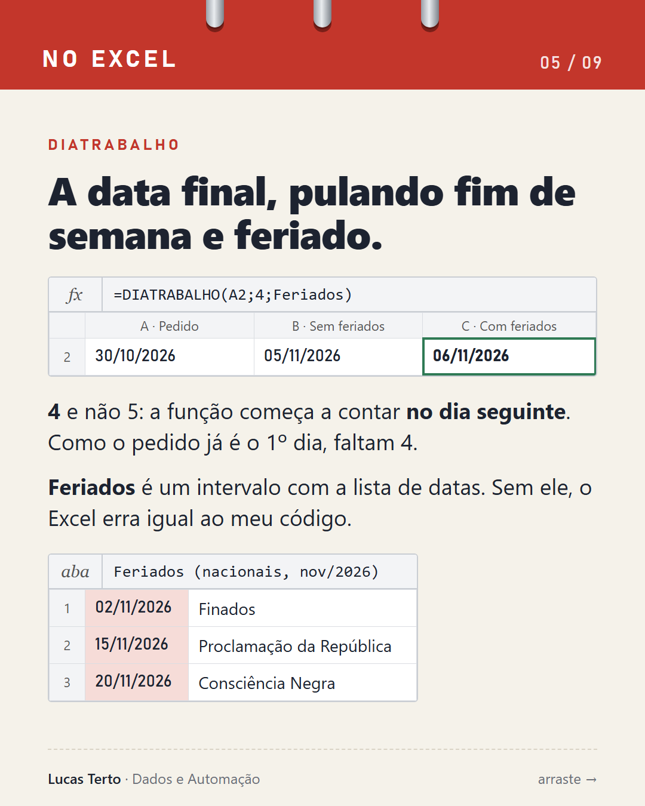

# Aula extra: feriado no meio do prazo

No feriado de 02/11/2026, uma conta de prazo da minha ferramenta errou por 1 dia. Para ela, dia útil era só "não é sábado nem domingo", e feriado não entrava na conta. Esta aula mostra o erro e como contar certo, no Excel e em código.

Planilha: [`planilha/dias-uteis-e-feriados.xlsx`](../planilha/dias-uteis-e-feriados.xlsx), com as abas Prazo, Mês e Feriados.
Carrossel em PDF (9 slides): na [release v1.1](https://github.com/TTV98/excel-formulas-na-pratica/releases).

> Exemplo fictício. Nenhum dado de pessoa.

## O cenário

Um documento leva **5 dias úteis** para ficar pronto, e o dia do pedido conta como o 1º dia, se for útil. O pedido foi feito na **sexta, 30/10/2026**. Em que dia o prazo termina?



| Regra | Dias contados | Prazo |
|---|---|---|
| Sem feriados | 30/10, 02/11, 03/11, 04/11, 05/11 | quinta, **05/11** |
| Com feriados | 30/10, 03/11, 04/11, 05/11, 06/11 | sexta, **06/11** |

Sem a lista de feriados, a linha ficaria verde 1 dia antes da hora.

## No Excel

A aba **Feriados** tem a lista de datas, e o intervalo nomeado `Feriados` aponta para ela (`Feriados!$A$2:$A$4`).

| Data | Feriado nacional |
|---|---|
| 02/11/2026 | Finados |
| 15/11/2026 | Proclamação da República |
| 20/11/2026 | Consciência Negra |



### Aba Prazo (A2 = 30/10/2026, B2 = 5)

| Célula | Fórmula | Resultado |
|---|---|---|
| C2 | `=DIATRABALHO(A2;B2-1)` | qui 05/11/2026 |
| D2 | `=DIATRABALHO(A2;B2-1;Feriados)` | sex 06/11/2026 |
| E2 | `=DIATRABALHO.INTL(A2;B2-1;11;Feriados)` | qui 05/11/2026 |
| F2 | `=DIATRABALHO.INTL(A2;B2-1;"0000001";Feriados)` | qui 05/11/2026 |

- **Por que `B2-1`:** o `DIATRABALHO` começa a contar no dia seguinte à data inicial. Como o pedido já é o 1º dia, faltam 4.
- **`DIATRABALHO.INTL`** serve para quem folga em outros dias. O código `11` e o texto `"0000001"` (de segunda a domingo, com 1 = folga) querem dizer "folga só no domingo". Com essa escala o sábado passa a contar, e o prazo volta para 05/11.

### Aba Mês (novembro de 2026)

| Célula | Fórmula | Resultado |
|---|---|---|
| B4 | `=DIATRABALHOTOTAL(B1;B2)` | 21 |
| B5 | `=DIATRABALHOTOTAL(B1;B2;Feriados)` | 19 |

Os dias 02/11 (segunda) e 20/11 (sexta) tiram 2 dias úteis. O 15/11 cai num domingo e não muda a conta.

## Em código (JavaScript)

Esta é uma versão didática, escrita para este repositório. Não é o código da ferramenta.

```js
// Prazo em dias úteis, pulando fim de semana e feriados (exemplo didático)
const FERIADOS = new Set(['2026-11-02', '2026-11-15', '2026-11-20']);

// Datas como texto 'AAAA-MM-DD', montadas no horário local (sem erro de fuso)
const iso = d => [d.getFullYear(), String(d.getMonth() + 1).padStart(2, '0'), String(d.getDate()).padStart(2, '0')].join('-');
const lerData = s => { const [a, m, d] = s.split('-').map(Number); return new Date(a, m - 1, d); };

const ehUtil = (d, feriados = FERIADOS) => {
  const w = d.getDay(); // 0 = domingo, 6 = sábado
  return w !== 0 && w !== 6 && !feriados.has(iso(d));
};

// O dia do pedido conta como o 1º, se for útil
const prazoUteis = (pedido, n, feriados = FERIADOS) => {
  const d = lerData(pedido);
  let contados = 0;
  while (true) {
    if (ehUtil(d, feriados)) contados++;
    if (contados === n) return iso(d);
    d.setDate(d.getDate() + 1);
  }
};

// Quantos dias úteis entre duas datas (as duas entram na conta)
const uteisNoPeriodo = (inicio, fim, feriados = FERIADOS) => {
  const d = lerData(inicio), f = lerData(fim);
  let n = 0;
  for (; d <= f; d.setDate(d.getDate() + 1)) if (ehUtil(d, feriados)) n++;
  return n;
};
```

| Chamada | Resultado |
|---|---|
| `prazoUteis('2026-10-30', 5, new Set())` | `'2026-11-05'` |
| `prazoUteis('2026-10-30', 5)` | `'2026-11-06'` |
| `uteisNoPeriodo('2026-11-01', '2026-11-30', new Set())` | `21` |
| `uteisNoPeriodo('2026-11-01', '2026-11-30')` | `19` |
| `prazoUteis('2026-11-02', 1)` (pedido no feriado) | `'2026-11-03'` |
| `prazoUteis('2026-10-31', 1)` (pedido no sábado) | `'2026-11-03'` |

## Checklist antes de confiar numa conta de prazo

- [ ] Os feriados estão numa aba própria, com um intervalo nomeado
- [ ] A lista tem os feriados nacionais, estaduais e municipais da cidade
- [ ] A lista é atualizada todo ano, porque os feriados móveis mudam de data
- [ ] Confirmei com a empresa se ponto facultativo conta ou não
- [ ] Testei com uma data conhecida

## O que foi testado

- **Excel:** as 6 fórmulas foram calculadas no Microsoft 365 em português do Brasil, em 02/11/2026, e deram os resultados das tabelas acima.
- **JavaScript:** o código foi rodado no navegador (Chromium) em 02/11/2026 e os 6 casos da tabela deram o resultado esperado.
- **Não testado:** LibreOffice, Google Planilhas e Excel em outros idiomas.
- **Na ferramenta:** o último slide do carrossel diz que a ferramenta vai passar a consultar uma lista de feriados. Isso é um plano e ainda não foi feito.
